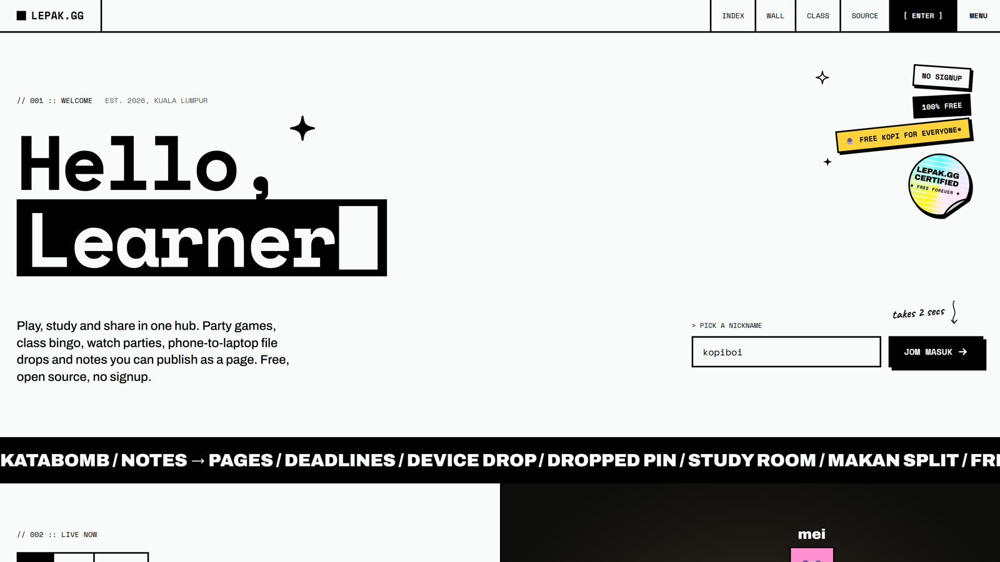
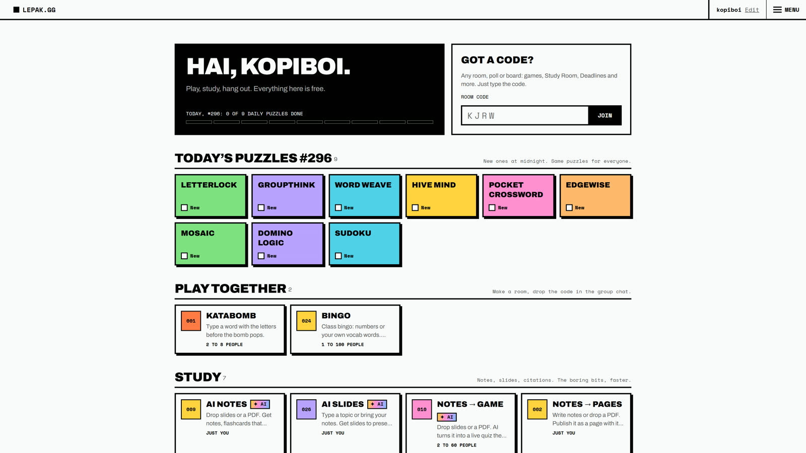
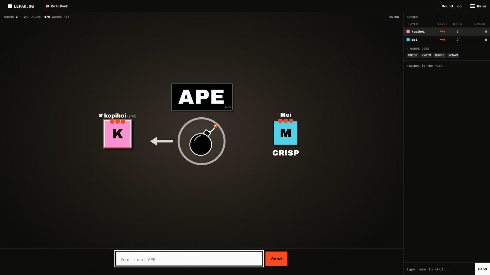
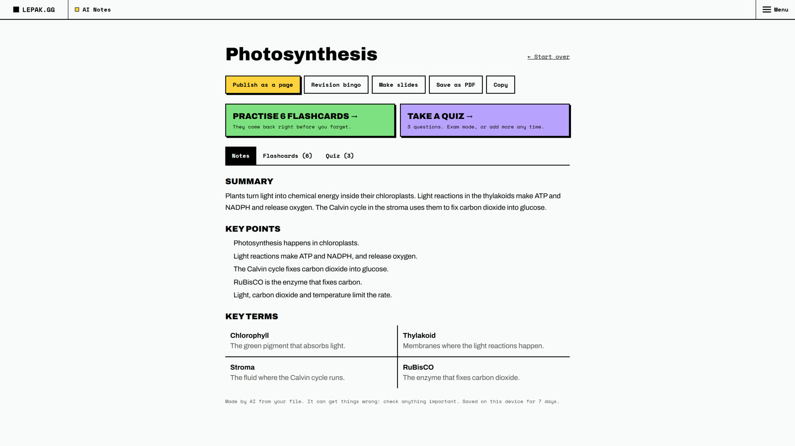
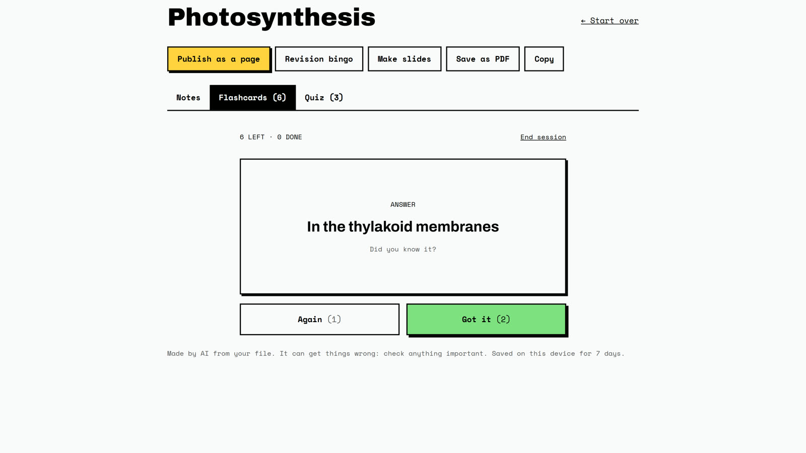
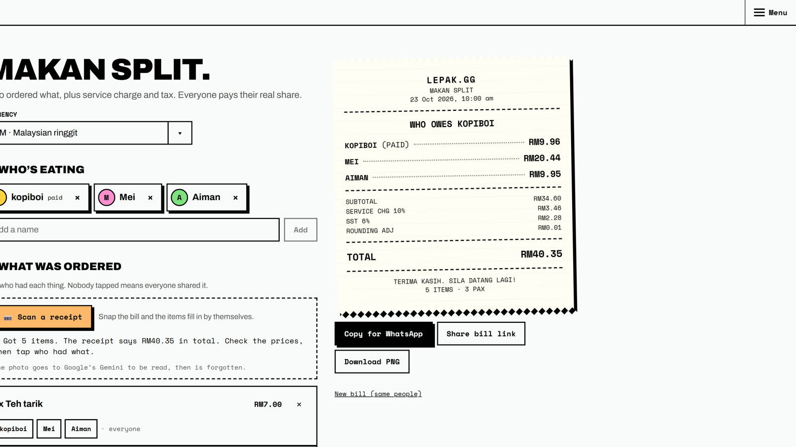
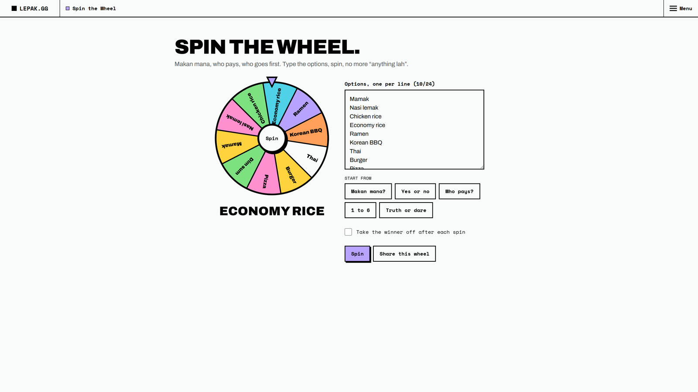

# ■ LEPAK.GG

**One free hub for students. Play, study and hang out, all in one place.**

No ads. No signup. Pick a nickname and go.

[**Try it: lepak-gg.vercel.app**](https://lepak-gg.vercel.app)

"Lepak" is Malaysian slang for hanging out. Lepak.gg is the place you open between classes, in a study group, or on the projector in a lecture: party games with friends, tools that make studying less painful, and the small things every group project needs, like splitting the makan bill or finding a time everyone is free.

Everything runs in the browser. Share a 4-letter code and your friends are in.

## Everything in one hub

| Play together | Study         | Hang out         | Daily puzzles                |
| ------------- | ------------- | ---------------- | ---------------------------- |
| KataBomb      | AI Notes      | Makan Split      | Letterlock                   |
| Bingo         | AI Slides     | Spin the Wheel   | Groupthink                   |
| Trivia        | Notes → Game  | Coin Flip        | Word Weave                   |
| Sudoku Race   | Notes → Pages | Watch Together   | Hive Mind                    |
| Ketik Race    | Deadlines     | Free-Time Finder | Pocket Crossword             |
|               | Study Room    | Device Drop      | Edgewise                     |
|               | Whiteboard    | Toolbox          | Mosaic, Domino Logic, Sudoku |
|               | Cite          |                  |                              |

## A closer look

### KataBomb

Type a word with the letters before the bomb pops. Make a room, send the code to the group chat, and play from any phone or laptop.

### AI Notes

Drop your lecture slides or paste a chapter. Get clean notes, flashcards that come back right before you forget, and a quiz.

| Notes                                                                       | Flashcards                                                |
| --------------------------------------------------------------------------- | --------------------------------------------------------- |
|  |  |

### Makan Split

Snap the receipt, tap who had what, and everyone pays their real share, with SST and service charge worked out to the sen. Send it straight to WhatsApp.

### Spin the Wheel

Makan mana? Who pays? Type the options and spin.

## For lecturers and teachers

Put Lepak.gg on the projector and students join on their phones with a 4-letter code. No student accounts, no app to install, nothing to pay. Turn your slides into a live quiz with Notes → Game, run revision bingo, share one deadline board with the whole class, or start a focus session together.

## Free, and private by default

- **Free.** No ads, no paid plans.
- **No signup.** A nickname is all you need. AI tools use a quick invisible guest sign-in, for security.
- **Things delete themselves.** Rooms, pages and guest data are cleared after they've been unused for a while. See the [Privacy page](https://lepak-gg.vercel.app/privacy) for exactly what is kept and for how long.

## About

Lepak.gg is made and run by [William Jonathan](https://github.com/williamjonathanliem). Ideas and bug reports are welcome: stick a note on the Wall on the site, or [open an issue](https://github.com/williamjonathanliem/lepak.gg/issues).

- **Website:** [williamjonathan.me](https://williamjonathan.me)
- **LinkedIn:** [in/williamjonathanliem](https://www.linkedin.com/in/williamjonathanliem/)
- **Email:** [william.jonathan.liem@gmail.com](mailto:william.jonathan.liem@gmail.com)

## Want to help?

Read [CONTRIBUTING.md](CONTRIBUTING.md) first: anything beyond a small fix needs an approved issue before you start. How to run it and how it's built are in [DEVELOPMENT.md](DEVELOPMENT.md).

## Licence, name and logo

The source code is licensed under [AGPL-3.0](LICENSE). If you run a changed copy for other people, even as a website, you must publish your full source code under the same licence and keep the copyright notices.

The name "Lepak.gg", the `LEPAK.GG` wordmark and the logo are not part of that licence (AGPL-3.0 section 7(e)). A copy must have its own name and branding, and must not be presented as the official Lepak.gg or as made or endorsed by me. The live services, databases, keys and user data are not part of the code either.

Open-source libraries and data used are listed in [CREDITS.md](CREDITS.md). Security problems, takedowns and questions about the name: [lepak.gg.my@gmail.com](mailto:lepak.gg.my@gmail.com).

## Contributors

Everyone whose work is merged gets credited here.

<!-- ALL-CONTRIBUTORS-LIST:START - Do not remove or modify this section -->
<!-- ALL-CONTRIBUTORS-LIST:END -->
